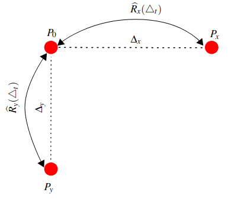
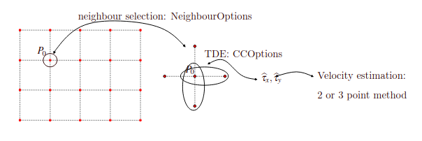

Velocity estimation
===================================

**velocity_estimation** is a Python library implementing the three-point velocity estimation technique described `here <https://doi.org/10.1063/5.0197251>`_.
This technique is tailored for coarse-grained imaging data, and has been applied to avalanche photodiode gass-puff imaging and synthetic data.

Other relevant repositories:

* `cmod functions <https://github.com/uit-cosmo/cmod_functions>`_: Gathering data from cmod tree, in xarray format.
* `blobmodel <https://github.com/uit-cosmo/blobmodel>`_: For generating 2D synthetic data.
* `xarray <https://github.com/pydata/xarray>`_: Manipulation of labelled multi-dimensional arrays.

Method description
------------------

The mathematical background for the method is explained in detail in `the paper <https://doi.org/10.1063/5.0197251>`_.
The basic idea is that in order to estimate velocities in two-dimensions, a minimum of three measurement points (or pixels) is needed.

This sketch describes the setup of three measuring points :math:`P_0`, :math:`P_x` and :math:`P_y` used to estimate the velocity components. :math:`R_x(\Delta_t)` and :math:`R_y(\Delta_t)` denote the cross-correlation function between points :math:`P_0`
and :math:`P_x`, and between :math:`P_0` and :math:`P_y`, respectively. Maximization of these cross-correlation function yields time lags :math:`\tau_x` and :math:`\tau_y`, which are used to estimate the velocity components according to

.. math::
    \widehat{v} &= \frac{\Delta x \widehat{\tau_x}}{\widehat{\tau_x}^2 + \widehat{\tau_y}^2 \Delta x^2/\Delta y^2 } \\
    \widehat{w} &= \frac{\Delta y \widehat{\tau_y}}{\widehat{\tau_y}^2 + \widehat{\tau_x}^2 \Delta y^2/\Delta x^2}

In standard imaging data, where more than three pixels are available, there are several combinations of three pixels that can be made starting from a reference pixel :math:`P_0`: one can go right and down, as shown in the image, but also right and up, or left and down, etc. The code is configured to take all possible combinations of pixels (typically four, but only two on the edges, and one in the corners), then it computes the velocities for each of them assuming that the data from each pixel fulfills some data-quality requirements, and lastly the estimated velocity for that reference pixel is estimated as the average over all estimated velocities.
With this in mind, we can roughly divide the algorithm in the following steps:

1. For each pixel :math:`P` in the dataset:
2. Find all horizontal and vertical neighbours of :math:`P` satisfying some user-defined :ref:`velocity_estimation-neighbour_selection`.
3. For each combination of [:math:`P` + one horizontal neighbour + one vertical neighbour]:
    1. Estimate the time delays, :math:`\widehat{\tau}_x` and :math:`\widehat{\tau}_y`, between the signal measured at :math:`P` and each auxiliary points with some user-defined :ref:`velocity_estimation-estimation_options`.
    2. It the time delay estimation succeeds, estimate the velocity components following a user defined velocity estimation option.
4. Average over all successful velocity estimations and assign the resulting velocity to :math:`P`.

This and the relevant options are summarize in the next figure:

Each set of options is described in each section:

1. :ref:`velocity_estimation-estimation_options-neighbour`.
1. :ref:`velocity_estimation-estimation_options-cc`.
1. :ref:`velocity_estimation-estimation_options-ca`.
1. :ref:`velocity_estimation-estimation_options-ccf`.
1. :ref:`velocity_estimation-estimation_options-velocity_method`.
1. :ref:`velocity_estimation-estimation_options-fca`.

.. _velocity_estimation-biases:

Biases of the time delays
-------------------------

For a superposition of pulses with a finite lifetime, elongated and tilted, the time delays are biased in three ways [LG]_:

* **Misalignment.** A two-point estimate overestimates the velocity component along the separation when the motion is oblique to it. The three-point method above removes this.
* **Decorrelation.** A finite lifetime, or any other factor of the cross-correlation that depends on the lag alone, pulls its maximum towards shorter lags. Both the two- and the three-point estimates then read too high, and bringing the points closer does not help.
* **Barber pole.** Elongated structures tilted with respect to their motion turn the three-point estimate towards their short axis and shorten it.

Two further estimators remove these biases. They are selected with ``EstimationOptions.velocity_method`` (see :ref:`velocity_estimation-estimation_options-velocity_method`), share the neighbour selection with the three-point method, and replace steps 3 and 4 above by one pooled least-squares fit per reference pixel. Both start from the cross-correlation of the model between the reference pixel and a pixel at separation :math:`\boldsymbol{\Delta}`, at lag :math:`\tau`,

.. math::
    R(\boldsymbol{\Delta}, \tau) = \rho(\tau/\tau_\mathrm{p})
    \exp\left[-\tfrac{1}{2}(\boldsymbol{\Delta} - \boldsymbol{v}\tau)^\mathsf{T} W^{-1}
    (\boldsymbol{\Delta} - \boldsymbol{v}\tau)\right],

where :math:`\rho` is the decorrelation due to the pulse lifetime :math:`\tau_\mathrm{p}` and :math:`W` is the covariance of the pulse autocorrelation, with half-widths :math:`\ell_1 \geq \ell_2` along its principal axes and its long axis tilted by :math:`\alpha` from the first coordinate axis.

* **Crossing time** (``VelocityMethod.CROSSING``). The crossing time :math:`\tau_\mathrm{e}` is the lag at which the cross-correlation of a pair equals the autocorrelation, :math:`R(0, \tau_\mathrm{e}) = R(\boldsymbol{\Delta}, \tau_\mathrm{e})`. The factor of the lag cancels, and :math:`\boldsymbol{\Delta}^\mathsf{T} W^{-1}\boldsymbol{v} = \boldsymbol{\Delta}^\mathsf{T} W^{-1}\boldsymbol{\Delta}/2\tau_\mathrm{e}`. For round pulses this is the velocity component along the separation, :math:`\hat{\boldsymbol{e}}\cdot\boldsymbol{v} = \Delta/2\tau_\mathrm{e}`, exactly, for any pulse shape and any lifetime. The code takes the mean of the two pixels' autocorrelations as :math:`R(0, \tau)` and combines the components along the separations to all neighbours in one least-squares fit. This removes the misalignment and the decorrelation, but not the barber pole.
* **Full correlation analysis** (``VelocityMethod.FCA``). The shape is measured at zero lag, where :math:`-2\ln R(\boldsymbol{\Delta}, 0) = \boldsymbol{\Delta}^\mathsf{T} W^{-1}\boldsymbol{\Delta}` is linear in the three elements of :math:`W^{-1}`. It is fitted over the pairs of the reference pixel with its neighbours and of each horizontal with each vertical neighbour, and the crossing equations with the measured :math:`W^{-1}` are then solved for :math:`\boldsymbol{v}` in one pooled least-squares fit per reference pixel. With :math:`W^{-1} = I` they reduce to the plain crossing time. FCA removes all three biases and also returns :math:`\ell_1`, :math:`\ell_2` and :math:`\alpha`. It follows the full correlation analysis of Briggs, Phillips and Shinn [BPS]_, Phillips and Spencer [PS]_ and Briggs [B84]_, adapted to the pulse model.

Limitations
^^^^^^^^^^^

* The shape equation :math:`-2\ln R(\boldsymbol{\Delta}, 0) = \boldsymbol{\Delta}^\mathsf{T} W^{-1}\boldsymbol{\Delta}` assumes Gaussian pulses; the crossing time does not.
* White noise adds a spike at zero lag to each pixel's autocovariance. ``FCAOptions.remove_noise_spike`` (on by default) replaces each pixel's variance by its autocovariance extrapolated to zero lag, which removes white noise only. Coherent pickup (in C-Mod data, the lines at 200 to 1000 kHz) and cross-talk between neighbouring channels are correlated between pixels; they raise :math:`R(\boldsymbol{\Delta}, 0)` and the cross-correlations and are not removed.
* With a spread of velocities the shape changes with the lag, :math:`W(\tau_\mathrm{e}) = W + \Sigma_V \tau_\mathrm{e}^2`, which the zero-lag shape does not contain.
* The extrapolation to zero lag needs a sampling time well below the correlation time.

References
^^^^^^^^^^

.. [LG] J. M. Losada and O. E. Garcia, *Velocity estimation from three-point measurements: decorrelation and barber-pole biases and their correction by full correlation analysis*, in preparation.
.. [BPS] B. H. Briggs, G. J. Phillips and D. H. Shinn, *The analysis of observations on spaced receivers of the fading of radio signals*, Proc. Phys. Soc. B **63**, 106–121 (1950), `doi:10.1088/0370-1301/63/2/305 <https://doi.org/10.1088/0370-1301/63/2/305>`_.
.. [PS] G. J. Phillips and M. Spencer, *The effects of anisometric amplitude patterns in the measurement of ionospheric drifts*, Proc. Phys. Soc. B **68**, 481–492 (1955), `doi:10.1088/0370-1301/68/8/301 <https://doi.org/10.1088/0370-1301/68/8/301>`_.
.. [B84] B. H. Briggs, *The analysis of spaced sensor records by correlation techniques*, in Handbook for MAP, Vol. **13**, edited by R. A. Vincent (SCOSTEP Secretariat, University of Illinois, Urbana, 1984), pp. 166–186.

Contents
--------

.. toctree::
    :caption: Contents
    :maxdepth: 1

    Installing <install>
    usage
    estimation_options
